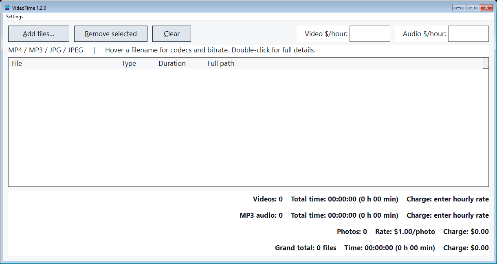
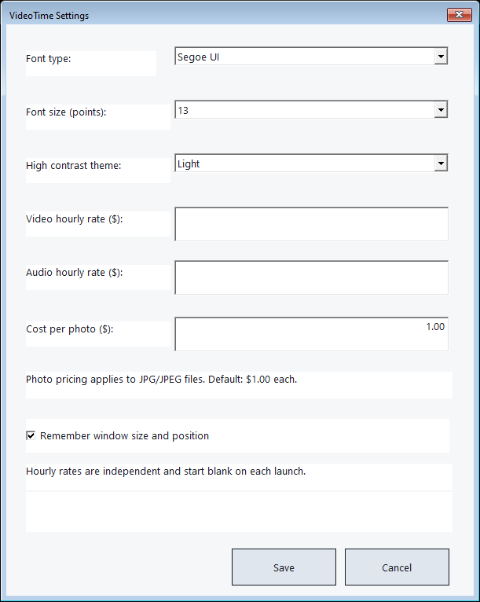

# VideoTime 1.2.0

VideoTime is an experimental, open source Windows tool for timing and pricing MP4 videos, MP3 audio, and JPG/JPEG photos. **Use at your own risk.** It is available under the [MIT License](LICENSE).

## How to use

1. Download the portable ZIP from [Releases](https://github.com/Kafaferanterenous/Video-Time-Win/releases), extract it, and open `videotime.exe`. No installer is needed.
2. Enter the **video hourly rate** and **audio hourly rate** separately. Both start blank each time the app opens; changing one never changes the other. Charges use unrounded durations. Blank or invalid prices prompt for a price instead of showing a misleading zero charge.
3. Use **Add files** or Ctrl+O to select MP4, MP3, or JPEG files. Video, audio, and photo totals appear separately, followed by a grand total. Photos start at $1.00 each; change that price in Settings.
4. Open **Settings > Preferences** (Ctrl+,) to change the font, font size (10–18 points), photo price, and Light, Dark, Blue, Navy, or Pastel theme. Tick **Remember window size and position** if you want VideoTime to reopen at the previous size and placement. This option starts off.
5. Hover over a filename for metadata; double-click it for a details window. Use Delete or **Remove** to remove selected rows, or **Clear** to remove all rows from the list. These actions never delete source files.

Settings save in `videotime.ini` beside the executable. Hourly video and audio rates apply to the current session only. The window setting saves its normal position and maximized state when enabled. If the folder is read only, changes apply for the current session and VideoTime explains that they could not be saved.

VideoTime reads media locally using Windows Media Foundation and Windows Imaging Component. It does not upload files, play media, or convert it. Some formats may be unsupported by the Windows installation; Windows N may require Microsoft's Media Feature Pack. The ZIP includes no user media or test audio.

## Build and verify

On Windows with Visual Studio C++ Build Tools and CMake, run `build.cmd`. Run `ctest --test-dir build --output-on-failure` and `build\videotime_tests.exe build\synthetic`. `python make_test_media.py <path-to-ffmpeg.exe>` can generate synthetic fixtures locally. `python acceptance_ui.py` tests the independent price fields and remembered window placement with an isolated app copy. `python package_portable.py` creates an allowlisted portable ZIP and SHA-256 hashes; it excludes media, private settings, and prompt history.
